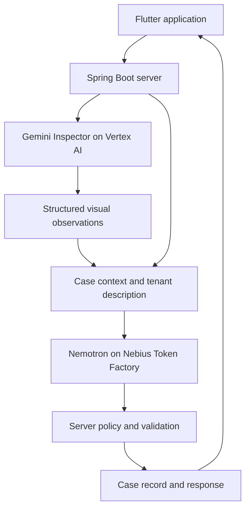

# 🏠 Dwell

### Your home. Your rights. Your next step.

**A multilingual AI case agent that helps renters document housing problems, navigate follow-ups, and assess repair outcomes.**

Built for the **Nebius × NVIDIA Global AI Hackathon**.

**Track:** Best Apps and Agents  
**Primary demo platform:** Web  
**License:** [MIT](./LICENSE)

[Live Demo](YOUR_LIVE_DEMO_URL) · [Demo Video](YOUR_PUBLIC_YOUTUBE_URL) · [Frontend](https://github.com/NebiusXNVIDIA-Global-AI-Hackathon/Dwell-FE) · [Backend](https://github.com/NebiusXNVIDIA-Global-AI-Hackathon/Dwell-BE)

---

## Overview

Dwell helps renters turn a confusing housing problem into a documented, manageable case.

Our initial focus is **New York City**, particularly first-time renters and people navigating housing issues in a language that is not their first.

Dwell brings evidence, landlord communications, assessments, and follow-up actions into one case history. As users add new evidence, **Deaver**, our conversational assistant, uses the accumulated context to update the assessment and next steps as appropriate.

| Item | Details |
| --- | --- |
| Track | Best Apps and Agents |
| Primary submitted platform | Flutter Web |
| NVIDIA model | `nvidia/NVIDIA-Nemotron-3-Nano-30B-A3B` |
| NVIDIA model inference | Live Nebius Token Factory API calls |
| Visual inspection | Fine-tuned Gemini 3.1 Flash-Lite on Google Vertex AI |
| Frontend hosting | Vercel |
| Backend hosting | AWS EC2 |
| Evidence storage | Amazon S3 |
| Project status | New project; first commit on October 8, 2026 |

---

## Why We Built Dwell

Dwell started with stories from friends who moved to the United States for university.

When something went wrong in their apartments, contacting the landlord was only the beginning. Repairs were delayed, forms were unfamiliar, and photos, messages, and complaint records were scattered across different apps.

Even after formally raising a dispute, the process could drag on until it became difficult to remember what had been promised and what still needed to happen.

They turned to AI tools for guidance, but worried about inaccurate legal references and procedures they could not independently verify.

Alongside classes and deadlines, they were becoming their own translators, researchers, and case managers.

**We built Dwell to bring that work into one continuous process—with a clear history and an actionable next step.**

---

## Try Dwell

### Live application

Open the [Web Demo](YOUR_LIVE_DEMO_URL).

The submitted demonstration runs in a browser. The Flutter codebase also includes mobile targets; the hosted web application is the primary judging experience.

### Demo video

Watch the [public YouTube demonstration](YOUR_PUBLIC_YOUTUBE_URL).

The video walks through a housing case and shows how live NVIDIA Nemotron inference through Nebius Token Factory supports the application.

### API demo access

The backend provides a demo account with a home, building records, and cases.

1. Open the backend Swagger UI:

   `YOUR_BACKEND_BASE_URL/swagger-ui.html`

2. Execute:

   `POST /api/v1/auth/demo`

3. Copy the returned access token.

4. Click **Authorize** in Swagger UI and enter the token.

5. Explore the seeded cases and documented endpoints.

The demo account is associated with `demo01@example.com`; the demo endpoint provides access without creating an account.

### Suggested walkthrough

1. Create a case with a description and visual evidence.
2. Review the severity assessment and its explanation.
3. Generate a landlord message and review its translation.
4. Add a landlord response in Deaver chat.
5. Upload additional evidence and review the updated case context.
6. Submit an after-repair photo through chat.
7. Review the repair assessment and next action.
8. Export the case report.

Demo-only time progression and simulated HPD events make longer case workflows observable within one session.

**Simulation controls are demonstration tools. They do not submit a complaint to a public agency or create a real HPD event.**

---

## Service Overview


## User Journey


### Case Creation and Evidence Collection


### AI Evidence Analysis


### Case Management and Tracking


### Deaver Assistant


---

## Core Features

| Feature | What it does |
| --- | --- |
| **Guided case creation** | Collects issue type, location, affected area, description, and supporting evidence. |
| **Evidence management** | Keeps uploaded materials associated with the case. Photos and videos support visual assessment. |
| **Contextual assessment** | Combines visual observations with the renter’s account and earlier evidence to assess severity and progression. |
| **Multilingual assistance** | Helps renters understand the case and prepares English landlord messages with translations. |
| **Case updates through chat** | Extracts relevant developments from conversation and advances the case workflow. |
| **Personalized checklists** | Turns case context into recommended follow-up actions. |
| **Repair review** | Compares before-and-after visual evidence and explains the outcome and next step. |
| **Evidence timeline and PDF** | Organizes case events and supporting material into a reviewable record and report. |
| **Building context** | Incorporates NYC public housing records into place-related information. |

### A case that develops with the evidence

New evidence is interpreted alongside the existing record.

A later photo may reveal worsening damage. A landlord’s reply may introduce a proposed visit. An after-repair image may support visible improvement or reveal that further evidence is needed.

Dwell preserves this context so the renter can continue without reconstructing the entire story.

---

## NVIDIA Nemotron and Nebius Integration

### A substantive role for Nemotron

Dwell uses **NVIDIA Nemotron 3 Nano** through **Nebius Token Factory** for seven application capabilities:

| Capability | Nemotron’s role |
| --- | --- |
| Severity assessment | Combines visual observations, tenant descriptions, and history into an assessment with reasons. |
| Deaver chat | Produces contextual multilingual responses and suggested actions. |
| Case-event detection | Extracts case developments from conversational updates. |
| Repair-verification explanation | Explains the verification result and next step. |
| Landlord communications | Drafts English messages with translations. |
| Personalized checklists | Adapts follow-up guidance to the case. |
| Report narratives | Generates a first-person case summary for the PDF report. |

All Nemotron calls go through the shared backend `NebiusChatClient`.

- **API base URL:** `https://api.tokenfactory.nebius.com/v1`
- **Endpoint:** `/chat/completions`
- **Deployed model:** `nvidia/NVIDIA-Nemotron-3-Nano-30B-A3B`
- **Integration:** Java `HttpClient`
- **Streaming:** Server-sent events delivered to the frontend

The deployed application uses Nano for both chat and assessment. Model selection is externalized through configuration.

### How Token Factory supported development

- **Hosted inference:** We integrated the model without operating a dedicated inference deployment.
- **OpenAI-compatible API:** A shared HTTP client supports multiple application features.
- **Streaming:** Generated text flows into the conversational interface, followed by cards, actions, and quick replies.
- **Per-request reasoning controls:** We use different settings for judgments and short writing tasks.
- **Usage-based billing:** The application calls hosted inference as cases require it.

During development, disabling reasoning for report narratives reduced observed generation times from approximately **15–30 seconds to 2–5 seconds**. These are development observations, not a controlled benchmark.

### Other Nebius services explored

We briefly explored a **Nebius AI Cloud L40S GPU VM** while investigating vision fine-tuning.

The final application uses Token Factory for Nemotron inference. The backend runs on **AWS EC2**; it is not deployed to Nebius Serverless Endpoints or Jobs.

---

## AI Architecture



### Visual Inspector

We fine-tuned **Gemini 3.1 Flash-Lite** using **831 indoor ceiling and wall images**:

- **706 training images**
- **125 validation images**
- Defect categories including leaks, mold, and cracks

The Inspector returns structured observations such as defect type, apparent severity, visible signs, active water, and extent.

It supports case analysis, evidence quality checks, and repair comparisons.

### Contextual Case Agent

The server combines visual observations with the tenant’s description, earlier observations, case history, and dates before calling Nemotron.

A photograph may show a dry area while the tenant reports active dripping. The assessment incorporates both and records the reason for an adjustment.

### Rules and source handling

- **SeverityPolicy:** Severity reductions are limited to one level and require a reason.
- **Nonvisual conditions:** Application rules account for issues such as heating-season heat and hot-water outages.
- **Unclear evidence:** Inconclusive images can trigger a retake request.
- **Follow-up windows:** High 24 hours, Medium 72 hours, and Low 7 days are user-confirmed suggestions, distinct from statutory repair deadlines.
- **Legal references:** The server selects from 26 stored NYC and New York State housing-law entries. Citation labels and links are rendered from the database.
- **Traceability:** Assessment outputs and reasons are stored as JSON.
- **Fallbacks:** Depending on the feature, malformed or unavailable model output can fall back to templates, default checklists, or inconclusive results.

Dwell supports documentation and informed follow-up. Visual comparisons cannot establish the condition of hidden building systems, and generated guidance does not replace a professional inspection or legal advice.

---

## Technology Stack

| Layer | Technology |
| --- | --- |
| Frontend | Flutter, Dart |
| State and UI logic | Riverpod, Flutter Hooks |
| Routing | GoRouter |
| Networking and server state | Dio, fquery |
| Local storage | shared_preferences, flutter_secure_storage |
| Frontend deployment | Vercel |
| Backend | Java 21, Spring Boot 4 |
| Security and persistence | Spring Security, JWT, Spring Data JPA |
| Database | PostgreSQL 17, pgvector, Flyway |
| Contextual reasoning | NVIDIA Nemotron 3 Nano via Nebius Token Factory |
| Visual analysis | Tuned Gemini via Google Vertex AI |
| Public data | NYC Open Data |
| Infrastructure | Docker, GitHub Actions, AWS EC2, Amazon S3 |
| API documentation | springdoc-openapi / Swagger UI |

---

## Repositories

| Component | Repository |
| --- | --- |
| Frontend | [Dwell-FE](https://github.com/NebiusXNVIDIA-Global-AI-Hackathon/Dwell-FE) |
| Backend | [Dwell-BE](https://github.com/NebiusXNVIDIA-Global-AI-Hackathon/Dwell-BE) |

---

## Run Locally

### Prerequisites

**Frontend**

- Flutter 3.47.7, matching the project’s web build environment
- Dart compatible with the project constraint `^3.13.5`
- Chrome for local web development

**Backend**

- Java 21
- Docker and Docker Compose
- Nebius Token Factory API key
- AWS S3 bucket and credentials for evidence uploads
- Google Vertex AI endpoint and service-account credentials for visual analysis
- Optional NYC Open Data application token

The backend can start without the Vertex AI endpoint, but visual severity falls back to `Inconclusive`. Configure both AI providers to reproduce the full demonstration.

### 1. Start the backend

```bash
git clone https://github.com/NebiusXNVIDIA-Global-AI-Hackathon/Dwell-BE.git
cd Dwell-BE
cp .env.example .env
```

Configure `.env` using the repository’s example file.

| Variable | Purpose |
| --- | --- |
| `DB_USERNAME` | PostgreSQL username |
| `DB_PASSWORD` | PostgreSQL password |
| `JWT_SECRET` | JWT signing secret, at least 32 characters |
| `NEBIUS_API_KEY` | Token Factory API key |
| `NEBIUS_MODEL` | Chat model ID |
| `NEBIUS_JUDGE_MODEL` | Optional assessment-model override |
| `AWS_REGION` | S3 region |
| `AWS_S3_BUCKET` | Evidence bucket |
| `GEMINI_ENDPOINT_URL` | Vertex AI endpoint for the Inspector |
| `GOOGLE_APPLICATION_CREDENTIALS` | Path to service-account credentials |
| `NYC_OPEN_DATA_APP_TOKEN` | Optional public-data access token |
| `DEMO_TIME_SHIFT_ENABLED` | Enables demo-only simulation controls |

Use the AWS default credential chain through environment credentials or an instance role. Ensure credentials and referenced files are available to the backend runtime.

Do not commit `.env`, API keys, or service-account credentials.

Build and start:

```bash
./gradlew bootJar
docker compose --env-file .env -f docker/docker-compose.yml up -d --build
```

PostgreSQL starts before the application, and Flyway initializes the schema and demo data.

Open:

```text
http://localhost:8080/swagger-ui.html
```

### 2. Start the frontend

In a separate terminal:

```bash
git clone https://github.com/NebiusXNVIDIA-Global-AI-Hackathon/Dwell-FE.git
cd Dwell-FE
flutter pub get
```

Configure `env/dev.json` with the backend address accessible from the browser. The application uses values including `APP_ENV` and `API_BASE_URL`.

Run the web application:

```bash
flutter run -d chrome --dart-define-from-file=env/dev.json
```

For a production web build, configure `env/prod.json`, then run:

```bash
flutter build web --release --dart-define-from-file=env/prod.json
```

The generated web application is located in `build/web`.

For hosted deployment, configure the backend to accept the frontend origin and ensure the frontend API URL points to the intended backend. Vercel deployment uses an SPA rewrite for application routes.

### 3. Run checks

Frontend:

```bash
flutter analyze
flutter test
```

Backend, with Docker running for Testcontainers:

```bash
./gradlew test
```

### Configuration behavior

| Situation | Behavior |
| --- | --- |
| Missing Nebius API key | Assistant chat returns an unavailable response; other AI features use their configured fallbacks. |
| Missing Vertex AI configuration | Visual severity falls back to `Inconclusive`. |
| Missing S3 access | Evidence-upload functionality requires storage configuration to be completed. |
| Demo simulation disabled | Demo time-shift and simulated HPD controls are unavailable. |

---

## Feedback on NVIDIA and Nebius

### What worked well

- Nemotron supported structured assessments that combined visual observations with the tenant’s account.
- English landlord notices were clear and appropriately formal.
- Token Factory’s HTTP interface and streaming fit our Spring Boot and Flutter architecture.
- Task-level reasoning controls helped reduce report-generation latency.

### Challenges encountered

- Korean phrasing sometimes required refinement, particularly when explaining subtle tone.
- Some responses included text around the requested JSON, requiring parsing and fallback handling.
- Console model names were not always easy to match to exact API model IDs.
- We encountered broken documentation links and uncertainty about endpoint input modalities.

### Improvements we would value

- Accessible pay-per-token NVIDIA vision inference.
- Clear model IDs and modality labels in the console.
- Guidance on combining reasoning controls with schema-constrained output.
- Request-level usage and cost attribution by feature or tag.
- Hosted options for adapting Nemotron to domain-specific tasks.

We did not run a formal head-to-head benchmark against other models on identical tasks. These observations describe our development experience.

---

## Project Timeline

Dwell is a new project. Its first commit was on **October 8, 2026**.

Nemotron-powered reasoning and language features were built with Nebius Token Factory from the start. The project does not rely on a pre-existing application submitted as a new build.

---

## What We Learned

**The next action depends on the history.** Useful assistance accounts for what happened, what was promised, and what remains unresolved.

**Language support includes interpretation.** Understanding the words in a landlord’s reply does not always make the next step clear.

**Reasoning should be configured by task.** A severity judgment and a short report summary have different requirements.

**Explicit boundaries help us improve the system.** Separating visual observations, contextual judgments, and server policies makes failures easier to inspect.

---

## Next Steps

- Pilot with first-time renters and tenant-support organizations.
- Evaluate severity and repair assessments against expert-reviewed cases.
- Test how reliably new evidence updates an existing case.
- Improve multilingual quality.
- Measure inference latency and cost per case.
- Evaluate NVIDIA vision models against the current Inspector.
- Expand beyond NYC with locally validated references and workflows.

Universities, relocation programs, and tenant-support organizations offer a practical path to reaching renters who are unfamiliar with local housing systems.

---

## Team

| Member | Role |
| --- | --- |
| [SoWho-J](https://github.com/SoWho-J) | Design & Frontend |
| [hxx-dev](https://github.com/hxx-dev) | Frontend |
| [seungminng123](https://github.com/seungminng123) | Frontend |
| [wjdah1028](https://github.com/wjdah1028) | Backend |
| [minho0805](https://github.com/minho0805) | Backend |
| [eunhasu03](https://github.com/eunhasu03) | Backend |

---

## License and Data Attribution

Project code is licensed under the [MIT License](./LICENSE).

Third-party models, datasets, and services remain subject to their respective licenses and terms.

The Inspector’s training and validation images were sourced from Roboflow Universe datasets identified by the team as CC BY 4.0. Training images are not included in this repository.

Public housing information is sourced from NYC Open Data.

---

**Moving to a new country is hard enough. Getting help with your home should not require navigating an unfamiliar system alone.**

Dwell gives renters a place to start, a record that grows with their case, and support through the next step.
