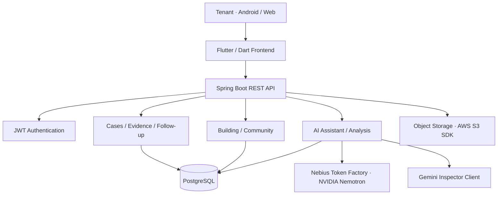

# 🏠 Dwell

### Your home. Your rights. Your next step.

**An AI-powered housing issue companion for non-native English-speaking tenants in New York City.**

Built for the **Nebius × NVIDIA Global AI Hackathon**.

---

## ✍️ Introduction & Overview

- **Service Name:** Dwell
- **Project:** Nebius × NVIDIA Global AI Hackathon
- **Target Users:** Non-native English-speaking tenants in New York City
- **Platforms:** Android & Web
- **Demo:** To be added

### 🔗 Repository

| Part | Repository |
| --- | --- |
| Frontend | [Dwell-FE](https://github.com/NebiusXNVIDIA-Global-AI-Hackathon/Dwell-FE) |
| Backend | [Dwell-BE](https://github.com/NebiusXNVIDIA-Global-AI-Hackathon/Dwell-BE) |

---


## 📌 Project Introduction

**Dwell** helps tenants turn a confusing housing problem into a documented, manageable case. From collecting evidence to understanding the next step, the platform brings housing issue reporting, AI-assisted guidance, and progress tracking into one experience.

The product focuses on tenants in **New York City**, particularly those navigating housing issues in a language that is not their first.


---

## 🖼️ Service Overview


## 🧭 User Journey


### 📝 MVP 1 — Case Creation & Evidence Collection


### 🤖 MVP 2 — AI Evidence Analysis

### 📊 MVP 3 — Case Management & Tracking


### 💬 AI Assistant


---

## ❗ The Problem

When a tenant discovers mold, a leak, broken heating, or another housing issue, taking action is rarely as simple as submitting a complaint.

- **Documentation is difficult.** Photos, messages, and incident details become scattered across devices and conversations.
- **The process is unclear.** Tenants may not know what evidence matters or what to do next.
- **Language adds friction.** Understanding housing terminology and communicating with a landlord can be intimidating.
- **Follow-up is easy to lose.** Deadlines, responses, inspections, and repair outcomes need to be tracked over time.

## 💡 Our Solution

Dwell combines **structured case creation**, **AI-assisted evidence analysis**, and **guided follow-up** in a single tenant-centered workflow.

```text
Housing issue detected
        ↓
Create a case and describe the problem
        ↓
Add supporting evidence
        ↓
AI-assisted analysis and case summary
        ↓
Review suggested actions and checklists
        ↓
Track updates, landlord communication, and repair progress
```

## ✨ Key Features

| Feature | What it helps tenants do |
| --- | --- |
| 📝 **Guided Case Creation** | Record the issue type, location, affected area, description, and evidence through a step-by-step flow. |
| 📷 **Evidence Collection** | Attach supporting materials, including images, video, audio, and documents, to a case. |
| 🧠 **AI-Assisted Analysis** | Turn submitted case information and evidence into structured observations and assessments for review. |
| 📂 **Reports & Case History** | Browse cases and inspect case details, statuses, timelines, and supporting evidence. |
| ✅ **Action Checklists** | Organize recommended next steps and monitor progress as a case evolves. |
| 💬 **AI Assistant** | Access case-related conversations, contextual guidance, and suggested actions. |
| 🏢 **My Place** | View place-related information and building signals in a dedicated workspace. |
| ✉️ **Landlord Communication** | Support notice preparation and track communications related to an issue. |
| 🔧 **Repair Verification** | Document and review the outcome of a reported repair. |
| 🤝 **Community** | Explore tenant discussions and shared experiences. |

> Features represent workflows and modules present in the project repositories. Availability and end-to-end integration may vary by build.

## 🤖 AI Workflow

Dwell uses AI as an **assistance layer**, while keeping the case record and user actions structured within the application.

1. **Collect context** — the tenant describes the issue and supplies relevant evidence.
2. **Analyze evidence** — backend services process evidence-related observations, quality checks, and severity assessment.
3. **Structure the case** — the application organizes findings into case information and summaries.
4. **Suggest next steps** — assistant conversations and checklist services help users understand possible follow-up actions.
5. **Keep the record** — case events, notices, and verification information support ongoing tracking.

**AI infrastructure and components identified in the backend:**

- **NVIDIA Nemotron via Nebius Token Factory** for language-model integration.
- **Nebius AI Cloud** as part of the project's infrastructure stack.
- A dedicated **Gemini inspector client** for vision-oriented inspection functionality.
- A legal-document domain with vector-compatible persistence for contextual legal information.

AI output is intended to assist documentation and decision-making, **not replace professional legal advice or an official inspection**.

## 🏗 Architecture



*High-level architecture based on the repository structure and declared dependencies; it does not guarantee that every integration is active in every environment.*

## 🎬 Demo

The project targets **Android APK and Web** experiences.

- **Live Demo:** Link to be added
- **Demo Video:** Link to be added
- **Android APK:** Link to be added

## 👥 Team Members


### Design & Frontend

<table>
  <tr>
    <td width="160">
      <a href="https://github.com/SoWho-J">
        
        <br/><b>SoWho-J</b>
      </a>
      <br/><sub>Design &amp; Frontend</sub>
    </td>
  </tr>
</table>

### Frontend

<table>
  <tr>
    <td width="160">
      <a href="https://github.com/hxx-dev">
        
        <br/><b>hxx-dev</b>
      </a>
      <br/><sub>Frontend</sub>
    </td>
    <td width="160">
      <a href="https://github.com/seungminng123">
        
        <br/><b>seungminng123</b>
      </a>
      <br/><sub>Frontend</sub>
    </td>
  </tr>
</table>

### Backend

<table>
  <tr>
    <td width="160">
      <a href="https://github.com/wjdah1028">
        
        <br/><b>wjdah1028</b>
      </a>
      <br/><sub>Backend</sub>
    </td>
    <td width="160">
      <a href="https://github.com/minho0805">
        
        <br/><b>minho0805</b>
      </a>
      <br/><sub>Backend</sub>
    </td>
    <td width="160">
      <a href="https://github.com/eunhasu03">
        
        <br/><b>eunhasu03</b>
      </a>
      <br/><sub>Backend</sub>
    </td>
  </tr>
</table>


## 🛠 Tech Stack

### Frontend


### Navigation & State


### Backend


### Database


### AI


### Infrastructure & Tools


---
