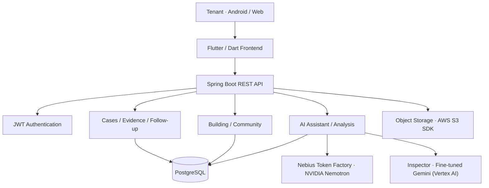

# 🏠 Dwell

### Your home. Your rights. Your next step.

**An AI-powered housing issue companion for non-native English-speaking tenants in New York City.**

Built for the **Nebius × NVIDIA Global AI Hackathon**.

---

## 🏆 Hackathon Submission at a Glance

| | |
| --- | --- |
| 🏁 **Track** | Best Apps and Agents |
| 🌐 **Live Demo** | **https://dwell-omega.vercel.app** (tap **"Try a demo account"**) |
| 🎬 **Demo Video (≤ 3 min)** | **https://youtu.be/R3j6sy3RzPQ** |
| 🟩 **NVIDIA Model** | NVIDIA Nemotron 3 Nano (`nvidia/NVIDIA-Nemotron-3-Nano-30B-A3B`), powering 7 features |
| ⚡ **Nebius** | Nebius Token Factory: every live Nemotron call is a runtime request to `api.tokenfactory.nebius.com/v1` |
| 💻 **Code** | [Dwell-FE](https://github.com/NebiusXNVIDIA-Global-AI-Hackathon/Dwell-FE) · [Dwell-BE](https://github.com/NebiusXNVIDIA-Global-AI-Hackathon/Dwell-BE) |
| 📜 **License** | MIT |
| 🗓 **Built** | From scratch during the Submission Period |

---

## 🧑‍⚖️ For Judges — Try Dwell in 3 Minutes

No installation or sign-up needed.

1. Open **https://dwell-omega.vercel.app** (best viewed in mobile view, e.g. 390 × 844, or on a phone).
2. On the login screen, tap **"Try a demo account"**.
3. Walk through the core flow:

| Step | Where | What to look for |
| --- | --- | --- |
| 1 | **Cases → + New Case** | Pick an issue (e.g. *Water & Flooding → Water Leak*), room, and exact spot. |
| 2 | **Add Evidence** | Upload a photo. AI checks *damage visible · clear and steady · surroundings included*. |
| 3 | **Add a description → Submit** | AI analyzes evidence + description and assesses severity. A case is created. |
| 4 | **Home** | The new case card appears with a live timeline and an AI checklist. |
| 5 | **View Case → View Case Analysis** | Severity reasoning and **Your Rights** with NYC Admin Code sections cited. |
| 6 | **Send a notice** | Nemotron drafts a polite English message to the landlord → *Yes, I sent it* → status becomes **Waiting for landlord's response** with a deadline countdown. Tap **Skip 24h** to simulate time passing. |
| 7 | **Got a Reply? Update Status** | Paste the landlord's reply (e.g. *"We will look into it."*). **Deaver** explains it, cites the law, and suggests next steps. |
| 8 | **My Place** | Building Signals, Building Insights (landlord track record), Neighbor Community. |
| 9 | **My Page → Manage Profile → Language** | Switch between English · 中文 · Español. |

> The demo account is shared. Data you create there may be visible to other judges.
> Dwell's AI output helps tenants document and decide. It does **not** replace professional legal advice or an official inspection.

---

## 🟩 How We Use NVIDIA Nemotron & Nebius

> **A model that sees. A model that decides. A server that governs.**

```
Photo / video ──► Tuned Gemini (Vertex AI) ──► structured observation (JSON)
                                                        │
Renter's words + earlier photos + dates + case law ─────┤
                                                        ▼
                         NVIDIA Nemotron 3 Nano (Nebius Token Factory)
                                                        │  assessment + reasons (JSON)
                                                        ▼
                                  SeverityPolicy (rules enforced in code)
                                                        ▼
                                  Renter: severity, why, and the next step
```

### 🧠 NVIDIA Nemotron 3 Nano: the model that decides

We use **NVIDIA Nemotron 3 Nano** (`nvidia/NVIDIA-Nemotron-3-Nano-30B-A3B`) on **Nebius Token Factory** as Dwell's case agent. It powers **seven features**:

| Feature | What Nemotron does |
| --- | --- |
| ⚖️ **Severity judgment** | Weighs the Inspector's observations against the tenant's own words, earlier photos of the same spot, and the case history. Then it makes the final call. |
| 💬 **Deaver chat** | Multilingual assistant, streamed over SSE (`token → card → action → quick_replies → done`). |
| 🔔 **Case-event detection** | Recognizes commitments in landlord replies (e.g. *"I'll come by Friday"*) and moves the case forward. |
| 🔧 **Repair-verification explanations** | Explains before/after verdicts: **Resolved**, **Disputed**, or **Inconclusive**. |
| ✉️ **Landlord messages** | Formal English drafts with a translation in the tenant's language. |
| ✅ **Personalized checklists** | Next steps tailored to the case. |
| 📄 **Report narratives** | First-person summary for the exportable PDF case report. |

**Why Nano:** a tenant case is not a single prompt. Every new photo, chat message, and landlord reply triggers another call. The 30B-A3B MoE activates only about 3B parameters per token, so we could **call Nemotron on every case event instead of rationing it**, and stream to a phone. It followed our JSON schemas and case rules reliably. As an open model with inspectable reasoning, it also fits a tool whose decisions a tenant may show to a landlord or a housing agency.

**How we adapted it:** prompt and context engineering with code-enforced guardrails. **We did not fine-tune Nemotron.** For every call, the server builds a structured JSON context: vision observations, the tenant's description in their own language, earlier observations of the same spot, case stage and history, today's date, heating-season status, and the relevant legal entries. Each of the seven tasks has its own system prompt and output schema.

### ⚡ Where Nebius Token Factory accelerated our workflow

Every Nemotron feature is a **live runtime call** to `https://api.tokenfactory.nebius.com/v1`.

- **OpenAI-compatible API.** A small Java `HttpClient` in our Spring Boot backend calls `/v1/chat/completions` directly. No vendor SDK, no GPUs to operate.
- **Per-request reasoning control.** Thinking stays on for severity and case updates. It is turned off for writing via `chat_template_kwargs: {"enable_thinking": false}`, which cut report-narrative generation from **about 15–30 s to 2–5 s**. `reasoning_content` and `<think>` blocks are stripped, so users see only the final answer.
- **Streaming end to end.** The token stream feeds our SSE chat protocol, so tenants watch the answer form and then get structured cards and next actions.
- **Config-driven model routing.** `NEBIUS_MODEL` (chat) and `NEBIUS_JUDGE_MODEL` (severity judge) are environment variables, so we tested Nemotron variants per role without code changes. The deployed app uses Nano for both.
- **Pay-per-token pricing.** Tenant demand is bursty (heating complaints spike in winter), and we pay nothing for idle GPUs.

We also tried an **L40S GPU VM on Nebius AI Cloud** while exploring vision fine-tuning and self-hosted serving. We then chose hosted inference to avoid always-on GPU cost. Our Spring backend runs on AWS EC2 with evidence in S3. **Nebius provides all live Nemotron inference.**

### ⚖️ The server: rules a model cannot override

- **SeverityPolicy.** Nemotron may raise severity freely. It may lower it by **at most one level**, and only with a stated reason.
- **What cameras can't see.** Heat and hot-water outages in heating season are always High. Unclear photos return Inconclusive and trigger a retake, unless the renter describes danger.
- **Suggestions, not orders.** Response windows (High 24h / Medium 72h / Low 7 days) are proposed, and the renter confirms.
- **Law the model cannot invent.** The server selects relevant entries from **26 curated NYC/NYS housing-law provisions**. Citation labels and links are rendered **from our database, never from model output**.
- **Every decision has a receipt.** Each assessment is stored as JSON with its reason.
- **Designed to fail gracefully.** Every Nemotron call has a fallback (template text, default checklist, or Inconclusive).

### 👁️ Other models & tools

| Model / tool | Role |
| --- | --- |
| **Gemini 3.1 Flash-Lite**, fine-tuned on Google Vertex AI | The Inspector: visual observations, evidence quality checks, before/after repair comparison. Fine-tuned on **831 indoor ceiling/wall images** (706 train / 125 validation). |
| **GPT** | Dataset labeling support for the vision Inspector. |
| **Claude Code** (Anthropic) | Coding assistant for frontend development, plus demo video production and README documentation. |

Why two providers: Nemotron 3 Nano is a text model, and NVIDIA's vision models on Token Factory were available only as dedicated GPU deployments. We paired Nemotron with a per-token vision model and let the server pass structured data between them. **Nemotron never sees pixels.** It judges structured observations in the context of the whole case.

---

## ▶️ How to Run

### Prerequisites

| Tool | Version |
| --- | --- |
| Flutter | 3.47.x (team standard: 3.47.6) |
| Dart | ≥ 3.13.5 < 4.0.0 |
| Chrome | Latest (for Web) |
| Android SDK + Emulator or device | For Android |

```bash
flutter --version
flutter doctor
```

### 1. Clone & Install

```bash
git clone https://github.com/NebiusXNVIDIA-Global-AI-Hackathon/Dwell-FE.git
cd Dwell-FE
git switch develop
flutter pub get
```

### 2. Environment Setup

```bash
cp env/example.json env/dev.json
```

```json
{
  "APP_ENV": "dev",
  "API_BASE_URL": "https://api.mynokim.cloud",
  "DWELL_ENABLE_MOCK_EVIDENCE_CHECK": "true"
}
```

| Key | Description |
| --- | --- |
| `APP_ENV` | `dev` or `prod` |
| `API_BASE_URL` | Dwell API server URL |
| `DWELL_ENABLE_MOCK_EVIDENCE_CHECK` | `true` enables the demo evidence-check flow |

### 3. Run

**Web**

```bash
flutter run -d chrome --web-port=3000 --dart-define-from-file=env/dev.json
```

> ⚠️ The API server (CORS) only allows `localhost:3000` and `localhost:5173`. Always pass `--web-port=3000`.

**Android**

```bash
flutter devices
flutter run -d <device-id> --dart-define-from-file=env/dev.json
```

### 4. Production Build (Web)

```bash
flutter build web --release \
  --dart-define=APP_ENV=prod \
  --dart-define=API_BASE_URL=https://api.mynokim.cloud \
  --dart-define=DWELL_ENABLE_MOCK_EVIDENCE_CHECK=true
```

Output: `build/web` (deployed on Vercel. See `vercel.json`).

### Backend

See the [Dwell-BE README](https://github.com/NebiusXNVIDIA-Global-AI-Hackathon/Dwell-BE) for backend setup. AI features need `NEBIUS_API_KEY` (Nebius Token Factory). Optional settings are `NEBIUS_BASE_URL`, `NEBIUS_MODEL` (default `nvidia/NVIDIA-Nemotron-3-Nano-30B-A3B`), and `GEMINI_ENDPOINT_URL`. Without a key, the app falls back to template responses.

---

## 💬 Feedback on Nebius & NVIDIA

### Nebius Token Factory: 8/10

Compared with the GPU VM + vLLM setup we briefly tried, Token Factory removed all serving work: no CUDA setup, no cold starts, no idle cost. We called hosted inference from our backend and streamed responses directly into the app. That let our small team spend its time on case logic and safety rules instead of infrastructure.

**Friction we hit**

- Matching console display names to exact API model IDs.
- Some older documentation links (e.g., custom model deployment) returned 404.
- The console did not make it clear which models accept image or audio input.

**What we'd like to see**

1. Public per-token NVIDIA vision models (e.g., Nemotron Nano VL, Cosmos Reason). This would let us collapse our two-provider pipeline into one NVIDIA stack.
2. Self-service Nemotron adaptation (e.g., serverless LoRA adapters) that keeps usage-based hosted inference, so we could tune it on housing-case language without moving to a dedicated deployment.
3. A "copy model ID" button and clear input-modality labels in the console.
4. Documented JSON-schema enforcement (`response_format: json_schema`) that works together with reasoning mode, so apps don't need parse-and-fallback logic.
5. Per-request token usage and cost attribution by tag, so we could report cost per tenant case directly.

### NVIDIA Nemotron

We did not run a formal head-to-head benchmark on identical text tasks. After building with three model families, roles settled clearly: GPT supported dataset labeling, a fine-tuned Gemini handles vision, and Nemotron handles everything that requires judgment over case context. Its structured, rule-bound reasoning was reliable enough to sit behind our policy layer, and Nano-scale cost and latency let us call it on every case event. Where we would still reach for a frontier proprietary model is natural-sounding Korean.

**What we'd like to see from NVIDIA**

1. **A compact multimodal Nemotron on usage-based hosted inference.** One model that reads housing evidence alongside the tenant's words and case history would simplify our architecture. We would especially value its ability to tell visible improvement apart from evidence that actually supports a repair conclusion, and to say clearly when it cannot tell.
2. **Stronger multilingual fidelity, especially in Korean and Spanish.** A translation must preserve the difference between an acknowledgment, a tentative plan, and a firm repair commitment. That difference decides what a renter does next.
3. **Production guidance for combining reasoning controls with schema-constrained output,** including streaming examples and evaluation recipes.

### Nebius AI Cloud

We briefly ran an L40S GPU VM with vLLM while exploring vision fine-tuning and self-hosted serving. For a small team with bursty demand, hosted per-token inference on Token Factory was the better fit, so all live inference moved there.

---

## 🗓 Project Timeline

Dwell was **created from scratch during the Submission Period** (August 26 – October 30, 2026).
The Dwell-FE repository was created on **September 17, 2026**, and Dwell-BE on **October 8, 2026**. No part of the project existed before the hackathon.

---

## 📜 License

Dwell is open source under the **[MIT License](https://github.com/NebiusXNVIDIA-Global-AI-Hackathon/Dwell-BE/blob/develop/LICENSE)**. © 2026 Dwell Team.

Demo video evidence photo: "Ceiling water damage", Wikimedia Commons, [CC BY 3.0](https://creativecommons.org/licenses/by/3.0/).

---

## ✍️ Introduction & Overview

- **Service Name:** Dwell
- **Project:** Nebius × NVIDIA Global AI Hackathon
- **Target Users:** Non-native English-speaking tenants in New York City
- **Platforms:** Android & Web
- **Live Demo:** https://dwell-omega.vercel.app
- **Demo Video:** https://youtu.be/R3j6sy3RzPQ

### 🔗 Repository

| Part | Repository |
| --- | --- |
| Frontend | [Dwell-FE](https://github.com/NebiusXNVIDIA-Global-AI-Hackathon/Dwell-FE) |
| Backend | [Dwell-BE](https://github.com/NebiusXNVIDIA-Global-AI-Hackathon/Dwell-BE) |

---


## 📌 Project Introduction

**Dwell** helps tenants turn a confusing housing problem into a documented, manageable case. From collecting evidence to understanding the next step, the platform brings housing issue reporting, AI-assisted guidance, and progress tracking into one experience.

The product focuses on tenants in **New York City**, particularly those navigating housing issues in a language that is not their first.


---

## 🖼️ Service Overview


### 📝 MVP 1 — Case Creation & Evidence Collection


### 🤖 MVP 2 — AI Evidence Analysis


### 💬 MVP3  AI Assistant


### 📊 MVP 4 — My Place


---

## ❗ The Problem

When a tenant discovers mold, a leak, broken heating, or another housing issue, taking action is rarely as simple as submitting a complaint.

- **Documentation is difficult.** Photos, messages, and incident details become scattered across devices and conversations.
- **The process is unclear.** Tenants may not know what evidence matters or what to do next.
- **Language adds friction.** Understanding housing terminology and communicating with a landlord can be intimidating.
- **Follow-up is easy to lose.** Deadlines, responses, inspections, and repair outcomes need to be tracked over time.

## 💡 Our Solution

Dwell combines **structured case creation**, **AI-assisted evidence analysis**, **guided follow-up**, and **repair verification** in a single tenant-centered workflow, in the tenant's own language.

```text
Housing issue detected
        ↓
Create a case: issue type, room, exact spot, description (any language)
        ↓
Add evidence → AI checks photo quality before upload
        ↓
Inspector (vision) + Nemotron judge severity, with reasons and NYC housing-law rights
        ↓
Nemotron drafts a formal English notice to the landlord (+ translation)
        ↓
Track the response deadline · Deaver interprets landlord replies
        ↓
Upload "after" photos → Resolved or Disputed
        ↓
Export a PDF case report
```

## ✨ Key Features

| Feature | What it helps tenants do |
| --- | --- |
| 📝 **Guided Case Creation** | File a case in a few taps: issue type, room, exact spot, and a description in any language. |
| 📷 **Evidence Collection & Quality Check** | Attach photos, video, voice notes, and documents. AI checks that the damage is visible, the shot is clear, and the surroundings are included. |
| 🧠 **AI Severity Analysis** | The Inspector (fine-tuned vision model) observes, NVIDIA Nemotron judges with the tenant's own words and case history, and server rules govern the final severity. |
| ⚖️ **Your Rights** | Relevant NYC/NYS housing-law provisions from 26 curated entries, with citations rendered from our database. |
| 📂 **Case Detail & Timeline** | Current status, timeline, evidence (originals saved and protected from tampering), and case history. |
| ✅ **AI Checklists** | Personalized next steps that change as the case moves forward. |
| ✉️ **Landlord Notice** | Nemotron drafts a polite, formal English message with a translation in the tenant's language. |
| ⏱ **Status & Deadline Tracking** | After the notice is sent, Dwell tracks the landlord's response window (High 24h / Medium 72h / Low 7 days). |
| 💬 **Deaver, AI Assistant** | Multilingual chat that interprets landlord replies (e.g. *"We'll look into it"*), cites the law, and offers one-tap next actions. |
| 🔧 **Repair Verification** | Compares before/after photos and returns **Resolved**, **Disputed**, or **Inconclusive**. A fresh coat of paint does not get a free pass. |
| 📄 **Case Report Export** | One-tap PDF report with timeline, evidence, correspondence, and applicable law. |
| 🏢 **My Place** | Building Signals (recurring issues), Building Insights (landlord's repair track record vs. NYC average), and Neighbor Community. |
| 🌍 **Multilingual UI** | Switch the whole app between English, 中文, and Español. |

## 🤖 AI Workflow

Dwell uses AI as an **assistance layer**, while keeping the case record and user actions structured within the application.

1. **Collect context.** The tenant describes the issue in their own language and adds evidence.
2. **See.** The Inspector (Gemini 3.1 Flash-Lite, fine-tuned on Vertex AI with 831 images) turns each photo into a structured observation.
3. **Decide.** NVIDIA Nemotron 3 Nano on Nebius Token Factory weighs observations, the tenant's words, earlier photos, and case history.
4. **Govern.** `SeverityPolicy` enforces rules in code, and legal citations come from our database, never from model output.
5. **Keep the record.** Every assessment is stored with its reason, and the case grows with every update.

AI output is intended to assist documentation and decision-making, **not replace professional legal advice or an official inspection**.

## 🏗 Architecture



## 🎬 Demo

The project targets **Android and Web** experiences.

- **Live Demo:** https://dwell-omega.vercel.app (tap **"Try a demo account"**)
- **Demo Video:** https://youtu.be/R3j6sy3RzPQ

## 👥 Team Members


### Design & Frontend

<table>
  <tr>
    <td width="160">
      <a href="https://github.com/SoWho-J">
        
        <br/><b>SoWho-J</b>
      </a>
      <br/><sub>Design &amp; Frontend</sub>
    </td>
  </tr>
</table>

### Frontend

<table>
  <tr>
    <td width="160">
      <a href="https://github.com/hxx-dev">
        
        <br/><b>hxx-dev</b>
      </a>
      <br/><sub>Frontend</sub>
    </td>
    <td width="160">
      <a href="https://github.com/seungminng123">
        
        <br/><b>seungminng123</b>
      </a>
      <br/><sub>Frontend</sub>
    </td>
  </tr>
</table>

### Backend

<table>
  <tr>
    <td width="160">
      <a href="https://github.com/wjdah1028">
        
        <br/><b>wjdah1028</b>
      </a>
      <br/><sub>Backend</sub>
    </td>
    <td width="160">
      <a href="https://github.com/minho0805">
        
        <br/><b>minho0805</b>
      </a>
      <br/><sub>Backend</sub>
    </td>
    <td width="160">
      <a href="https://github.com/eunhasu03">
        
        <br/><b>eunhasu03</b>
      </a>
      <br/><sub>Backend</sub>
    </td>
  </tr>
</table>


## 🛠 Tech Stack

### Frontend


### Navigation & State


### Backend


### Database


### AI


### Infrastructure & Tools


---
